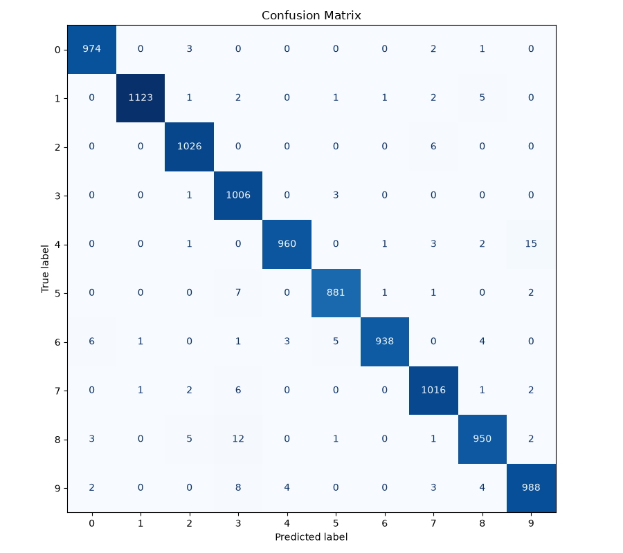
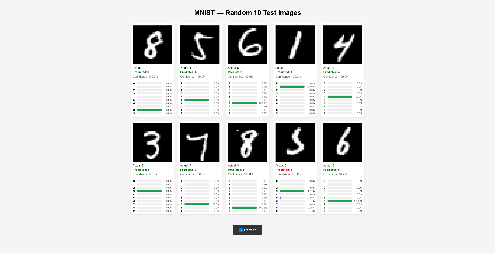

# MNIST Digit Classification Using PyTorch
A simple convolutional neural network built with PyTorch to classify handwritten digits.

# Dataset
MNIST dataset

# Model Architecture
- Image: 1 channel, 28 by 28
- Conv2d: 1 to 6 feature maps, kernel_size=3
- ReLU + MaxPool
- Conv2d: 6 to 16 feature maps, kernel_size=3
- ReLU then MaxPool
- Flatten
- Linear: 400 to 120, ReLU
- Linear: 120 to 84, ReLU
- Linear: 84 to 10

# Test Performance
-Test Loss: 0.0462
-Test Accuracy: 98.62%
-Test Error: 1.38%

<h1>Confusion Matrix</h1>

  

# Web App

A Flask page that loads the trained weights and shows 10 random images with predictions from the test set.

 

  

# How to run
python -m webapp.app
